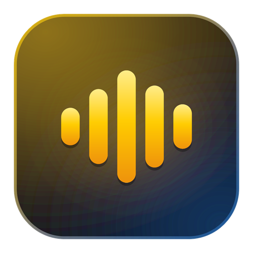

<p align="center">
  
</p>

<h1 align="center">OmniWave</h1>

<p align="center">
  Лёгкий музыкальный комбайн и компактный плеер для Windows 10/11 в стиле <strong>Chroma Card (Zero-Blur)</strong><br />
  с единым окном, плавающей пилюлей, умной группировкой треков, мостом браузера <strong>OmniWave Bridge</strong> и встроенным прокси.
</p>

<p align="center">
  
  
  
  
  
</p>

---

## ⚡ Быстрый запуск (готовый `.exe`)

1. Скачайте репозиторий (**Code → Download ZIP** и распакуйте архив, либо выполните `git clone https://github.com/yammikid/OmniWave.git`).
2. Запустите **`DynamicIsland.exe`** прямо из основной папки — компиляция не требуется *(утилита `yt-dlp.exe` уже включена в комплект)*.
3. Если Windows попросит среду выполнения, установите лёгкий **[.NET 8 Desktop Runtime (x64)](https://dotnet.microsoft.com/download/dotnet/8.0)** *(для запуска готового `.exe` SDK не нужен)*.

> [!TIP]
> **Автообновление с GitHub:** при запуске приложение проверяет новую версию в репозитории и позволяет обновиться в один клик прямо из вкладки **«Настройки»**.

---

## 🎵 Поддерживаемые площадки

| Площадка | Возможности в OmniWave |
| :--- | :--- |
| **Яндекс Музыка** | Вход через **ваш системный браузер** (OAuth Device Flow) или импорт JSON; потоковая «Моя волна» с антиповторами, синхронизация лайков и плейлистов, экспорт отдельного трека из «Избранного» в лайки Яндекса и двусторонняя синхронизация удаления треков. |
| **ВК Музыка** | Авторизация через **ваш основной браузер** (OAuth / перехват ссылки / 1-клик через расширение **OmniWave Bridge**); доступ к аудиозаписям, плейлистам с синхронным удалением треков и персональному потоку **«VK Микс»**. |
| **Spotify** | Поиск и прослушивание треков **даже без аккаунта**, вход через **системный браузер** по OAuth2 PKCE и/или синхронизация `sp_dc` через **OmniWave Bridge** (устойчиво к `HTTP 429`), синхронизация «Любимых треков» и плейлистов с двусторонним удалением, прямые ссылки `open.spotify.com`. |
| **SoundCloud** | Мгновенный поиск и стриминг; собственный C#-переупаковщик фрагментов HLS (`fMP4 → M4A`) без `ffmpeg` для точной и плавной перемотки. |
| **YouTube / YouTube Music** | Быстрый поиск и стриминг через встроенный прокси с локальным `Range/206`-ретранслятором; подключение cookies в 1 клик через **OmniWave Bridge** или импорт `cookies.txt`. |
| **Audius, Bandcamp, Радио** | Независимые музыкальные каталоги и онлайн-радиостанции в прокручиваемой панели фильтров. |

---

## ✨ Ключевые возможности

### 🎴 Интерфейс Chroma Card (Zero-Blur) и Компактная пилюля
- **Единое окно без модов и размытия (`0% GPU Blur`):** вся работа приложения — поиск, очередь, избранное, плейлисты и настройки — собрана в одном быстром окне на базе WebView2 без `Acrylic`/`backdrop-filter` эффектов, благодаря чему интерфейс работает плавно и экономит ресурсы на Windows 10 и Windows 11.
- **2 нативных режима окна:** полноценная карточка **Expanded (`400×604`)** и компактная плавающая пилюля **Compact Pill (`348×84`)** с переключением кнопкой в заголовке, двойным кликом или клавишей `M`.
- **Умное сворачивание за край экрана и громкость в пилюле:** в компактном режиме доступен отдельный ползунок громкости и автоскрытие за левый, правый или верхний край экрана — при наведении курсора пилюля плавно выезжает, позволяя переключить трек или убавить звук, и аккуратно сворачивается обратно.
- **Нативная интеграция с Windows 10/11:** скруглённые углы без чёрных зазоров и рамок, кнопка **Pin** («Поверх всех окон»), настройка прозрачности окна (`75–100%`), запоминание координат с защитой от выхода за пределы мультимониторных конфигураций и защита от повторного запуска.

### 🔎 Умный поиск, группировка дублей и панель фильтров
- **Объединение одинаковых треков:** дубли одного и того же трека с Яндекса, ВК, Spotify, SoundCloud и YouTube объединяются в единую сгруппированную карточку — вы сразу видите доступные площадки, сами выбираете источник для воспроизведения и не получаете повторов в очереди.
- **Горизонтальная прокрутка фильтров:** удобная прокрутка чипов площадок и потоков (`Все`, `Я.Музыка`, `VK`, `Spotify`, `SC`, `YT`, `Радио`, `Моя волна`, `VK Микс`) колесом мыши, перетаскиванием или стрелками `‹ ›`.
- **Защита `TrackMatcher` и приоритет артиста:** строгая сверка по названию, исполнителю, длительности и тегу версии отсеивает случайные `Slowed`, `Speed Up`, `Remix`, `Cover`, `Karaoke` и короткие сниппеты.

### 📂 Библиотека, Drag & Drop и двусторонняя синхронизация
- **Перетаскивание треков (Drag & Drop):** меняйте порядок композиций мышкой во всех списках — в поиске, очереди, «Избранном» и любом плейлисте.
- **Закрепление плейлистов и синхронизация:** закрепляйте важные плейлисты кнопкой Pin, переносите отдельные треки из «Избранного» прямо в Яндекс Музыку и удаляйте треки из плейлистов с синхронизацией изменений в **Яндекс Музыке**, **ВК** и **Spotify**.
- **Офлайн-загрузки:** сохранение треков локально на диск (`MP3 / M4A / FLAC`) для мгновенного воспроизведения без интернета.

### 🔗 Авторизация через системный браузер и OmniWave Bridge
- **Вход без встроенного браузера:** все подключения аккаунтов открываются в вашем **основном системном браузере** (OAuth Device Flow для Яндекса, OAuth2 PKCE для Spotify, мобильный OAuth для ВК), где у вас уже сохранены пароли и сессии.
- **Локальное расширение `OmniWave Bridge` (Manifest V3):** при нажатии **«Мост браузера (1 клик)»** программа открывает папку готового локального расширения и подключает открытые вкладки Яндекса, ВК, Spotify и YouTube к плееру по защищённому локальному каналу (`127.0.0.1` + секретный токен `X-OmniWave-Token`).

### 🎚️ Звук, эквалайзер, прокси и оптимизация ресурсов
- **10-полосный эквалайзер и скорость:** выключен по умолчанию, 8 готовых пресетов, предусиление, регулировка скорости `0.75x – 1.5x`, честный Mute и точная перемотка (включая SoundCloud и Spotify) с предпросмотром времени.
- **Тексты песен и горячие клавиши:** синхронизированные тексты из `LRCLIB`, глобальные медиа-клавиши `Fn` даже поверх игр и полноэкранных программ.
- **Встроенный прокси и режим трея:** маршрутизация `HTTP / HTTPS / SOCKS5 / SOCKS4` (с логином/паролем, тестом задержки и обходом для Яндекс / ВК), а при сворачивании в трей WebView2 ставится на паузу со сбросом неиспользуемой памяти (`TrimWorkingSet`).

---

## 📋 Требования

- **Windows 10 / 11** (`x64`)
- **[.NET 8 Desktop Runtime (x64)](https://dotnet.microsoft.com/download/dotnet/8.0)** — для запуска готового `DynamicIsland.exe` *(или **[.NET 8 SDK (x64)](https://dotnet.microsoft.com/download/dotnet/8.0)** для сборки из исходников)*
- **Microsoft Edge WebView2 Runtime** *(предустановлен в Windows 11)*
- **`yt-dlp.exe`** — **уже включён в репозиторий** рядом с `DynamicIsland.exe`

---

## 🛠 Сборка из исходников (для разработчиков)

1. Установите **[.NET 8 SDK (x64)](https://dotnet.microsoft.com/download/dotnet/8.0)** *(именно **SDK**, не Runtime; скрипт [`build.bat`](build.bat) также проверяет его наличие и при необходимости предлагает установку через `winget`)*.
2. Скачайте код (`git clone https://github.com/yammikid/OmniWave.git` или **Code → Download ZIP**).
3. Запустите [`build.bat`](build.bat) или соберите проект вручную через PowerShell:

```powershell
# Клонирование репозитория
git clone https://github.com/yammikid/OmniWave.git
cd OmniWave

# Сборка single-file приложения (Win10/11 x64)
dotnet publish -c Release -r win-x64 --self-contained false -p:PublishSingleFile=true -p:IncludeNativeLibrariesForSelfExtract=false -o ./publish

# Запуск собранного приложения
.\publish\DynamicIsland.exe
```

---

## 🔒 Приватность и безопасность

Все OAuth-токены, cookie авторизации (`sp_dc`, `remixsid`, YouTube cookies), настройки прокси, локальные плейлисты, избранное и секрет локального моста (`BridgeSecret`) хранятся **исключительно локально** на вашем ПК в `%AppData%\OmniWave` (`settings.json`, `library.json`). Локальный сервер **OmniWave Bridge** слушает только `127.0.0.1` и требует заголовок `X-OmniWave-Token` — никакие личные данные никогда не отправляются в репозиторий или сторонним серверам.
